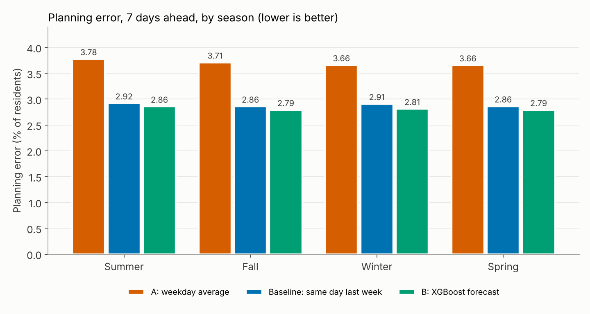
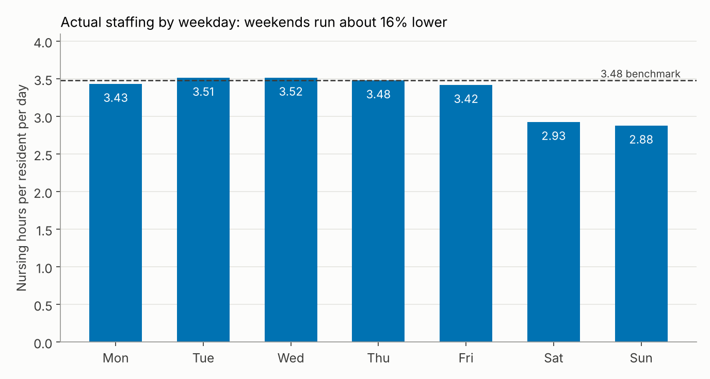
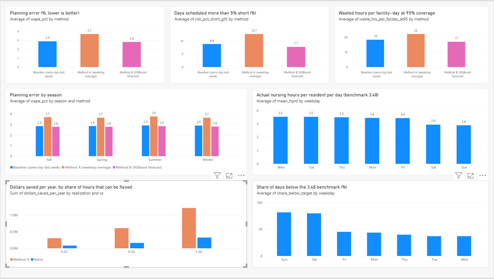

# Nursing home staffing: does a forecast beat the weekday average?

A backtest on **real data**: three years of daily nurse staffing from Texas nursing homes (CMS Payroll Based Journal, July 2023 to June 2026, about 1.27 million facility-days, 1,197 facilities).

I built this to learn how staffing demand, schedule efficiency and workload distribution are analyzed, using a field where real data is public. The questions are the same ones an airport operations team asks: *how many people do we need, when, and is a new planning tool worth it?*

## Result in one paragraph

Scheduling from a **forecast model (XGBoost)** was more accurate than the usual **weekday-average** rule in every season, every weekday and every facility size. Pooled over four test months (one per season), planning error fell from 3.70% to 2.81% of residents, and the share of facility-days scheduled more than 5% short fell from 12.7% to 7.7%. **The honest catch:** most of that gain comes from simply using *last week's census* instead of a weekday average. The XGBoost model adds a small extra improvement (0.07 percentage points, 95% interval 0.06 to 0.09), which is real but small. Whether it is worth building depends on the size of the operator (see ROI).

## Methods compared

Planning horizon: schedules are set **7 days ahead**, using only census known up to that day.

| | Method | How it forecasts census for day t |
|---|---|---|
| **A** | Weekday average (the usual way) | Average census of the same weekday over the previous 8 weeks |
| **Baseline** | Same day last week | Census on day t-7 (a free, no-model benchmark) |
| **B** | XGBoost forecast (the new tool) | Predicts census change from recent levels, trend, weekday, month, facility size |

Scheduled hours = forecast census x **3.48** hours per resident per day. Needed hours = actual census x 3.48. The 3.48 benchmark is an **assumption** (a figure used in CMS's 2024 minimum-staffing rule, not a requirement I am claiming applies). It scales hours and dollars but **does not change which method wins**, because both methods use the same target.

## How it was tested (walk-forward, no peeking)

For each test month the models are retrained using **only data from before that month**:

| Test month | Season | Trained on |
|---|---|---|
| Jul 2025 | Summer | Jul 2023 to Jun 2025 |
| Oct 2025 | Fall | up to Sep 2025 |
| Jan 2026 | Winter | up to Dec 2025 |
| Apr 2026 | Spring | up to Mar 2026 |

An adjacent month for each season (Aug, Nov, Feb, May) was also run as a check, so one odd month cannot decide a season. Model settings were tuned **once**, on Mar to Jun 2025 (before any test month), then locked (max depth 4, learning rate 0.1). All three methods are scored on the **same** 141,664 facility-days.

## Results (4 test months, pooled)

| KPI | A: weekday average | Baseline: last week | B: XGBoost |
|---|---|---|---|
| Planning error (% of residents) | 3.70% | 2.89% | 2.81% |
| Mean miss (residents) | 2.80 | 2.18 | 2.13 |
| **Risk**: facility-days scheduled >5% below need | 12.7% | 8.8% | 7.7% |
| Risk: facility-days scheduled >10% below need | 1.96% | 1.17% | 0.83% |
| Buffer needed to cover 95% of days | 8.2% | 6.9% | 6.3% |
| **Wasted hours per facility-day at 95% coverage** | 22.2 | 18.4 | 17.0 |

Difference in planning error, with a 95% interval from resampling facilities: **A minus B = 0.89 points (0.84 to 0.94)**; **Baseline minus B = 0.07 points (0.06 to 0.09)**.

Planning error by season:

| Season | A | Baseline | B |
|---|---|---|---|
| Summer | 3.78% | 2.92% | 2.86% |
| Fall | 3.71% | 2.86% | 2.79% |
| Winter | 3.66% | 2.91% | 2.81% |
| Spring | 3.66% | 2.86% | 2.79% |

## What actually happens in the real data (workload distribution)

Residents do not change by weekday, but staffing does. Using reported hours (days with implausible hours excluded):

| Weekday | Hours per resident | Days >5% below 3.48 | Agency (contract) share of hours |
|---|---|---|---|
| Mon | 3.43 | 44% | 2.9% |
| Tue | 3.51 | 37% | 2.5% |
| Wed | 3.52 | 37% | 2.5% |
| Thu | 3.48 | 40% | 2.6% |
| Fri | 3.42 | 45% | 2.9% |
| Sat | 2.93 | 80% | 3.8% |
| Sun | 2.88 | 82% | 3.9% |

Weekends run about **16% lower** (2.90 vs 3.47 hours per resident). Across all days, 52% of facility-days were staffed more than 5% below the 3.48 benchmark, and agency staff made up only 3.0% of hours. This is a schedule-efficiency finding that a forecast alone does not fix: demand is flat across the week while staffing is not.

## ROI (assumptions are labeled and flexed)

The file has **no wages and no cost to switch**, so these are placeholders, not facts. Scenario: an operator with **20 facilities**, a blended cost of **$32 per nursing hour**, a one-time cost of **$75,000** to build and maintain the tool, and 3.48 hours per resident. Savings come from fewer wasted buffer hours at the same 95% coverage. Because not every hour can really be flexed day to day, I show what happens if only 25%, 50% or all of those hours can be cut.

| Switching from | 25% of hours flexible | 50% | 100% (upper bound) |
|---|---|---|---|
| **A (weekday average)** to B | $304,472/yr (ROI 306%) | $608,944/yr (ROI 712%) | $1,217,887/yr (ROI 1,524%) |
| **Baseline (last week)** to B | $81,213/yr (ROI 8%) | $162,426/yr (ROI 117%) | $324,852/yr (ROI 333%) |

ROI = (savings minus switching cost) divided by switching cost. Full grid (wages $25 to $40, switching cost $25K to $250K, targets 3.2 to 3.8, 20 facilities vs all Texas) is in `results/roi_sensitivity.csv`.

**Reading it:** moving off the weekday average pays off under almost any assumption. Moving from the free "last week" rule to XGBoost is marginal for a small operator (ROI near break-even at 25% flexibility, and negative when the switching cost is high), and only clearly pays at larger scale. My recommendation would be: **stop using the weekday average first; adopt the model only if the operator is large enough to absorb the build cost.**

**Agency vs buffer:** holding a buffer in own staff to cover 95% of days costs about 16.6 extra hours per facility-day, while filling the shortfalls of a lean schedule with agency staff takes about 3.6. Agency is cheaper unless it costs more than about **4.6x** the normal rate (this assumes agency staff can be found on short notice).

## Power BI dashboard

One page with the key results: planning error, days scheduled short, wasted hours at 95% coverage, error by season, real staffing by weekday against the 3.48 benchmark, and the ROI range. Open `powerbi/staffing-dashboard.pbix` in Power BI Desktop (data is stored in the file; the four source CSVs are in `powerbi/`). The ROI chart is filtered to a $32 wage, a $75,000 build cost and a 20-facility operator, which are labeled assumptions.

## Data cleaning (every rule logged)

| Rule | Rows touched |
|---|---|
| Raw rows loaded (12 quarterly files, Texas only, no duplicates) | 1,276,922 |
| Census of 0 or less set to missing (new facilities ramping up) | 116 |
| Facilities dropped for chronic implausible hours (>10 hours per resident on over 10% of days) | 3 facilities, 2,375 rows |
| Daily hours set to missing (over 10 or under 0.5 hours per resident, e.g. a 35-hour-per-resident entry) | 2,859 |
| Isolated census spikes | 0 found |
| Rows after cleaning | 1,274,547 (1,197 facilities) |

Census step changes at the start of a month were kept (27 rows jumped by more than 50%): they look like real level shifts that any forecast has to live with.

## Limits (please read)

- **No wages and no quality outcomes** (falls, complaints) in the data, so "better" means coverage and cost, not patient results. All dollar figures rest on labeled assumptions.
- **The 3.48 hours benchmark is an assumption**, used consistently for all methods.
- This is a **backtest**: it shows what would have happened on past data, not a guarantee.
- The models forecast **census (number of residents)**, not workload by shift or by role. Real planning also depends on case mix, shifts and labor rules.
- **One month per season** is tested; the adjacent-month check supports but does not replace more years.
- The weekday-average method is weak mainly because census does not follow a weekday pattern. A smarter baseline (last week) closes most of the gap, which is why that comparison is included.

## Reproduce

Data: CMS Payroll Based Journal Daily Nurse Staffing (data.cms.gov), filtered to STATE = TX, quarters 2023Q3 to 2026Q2. Raw files are not included here (they are public and large); place them under `data/raw/` and run in order: `src/prep.py`, `src/clean.py`, `src/forecast.py`, `src/analysis.py`, `src/figures.py`. Python 3.13, pandas, numpy, xgboost, scikit-learn, matplotlib.

## Files

`src/` code, `results/` all result tables, `figures/` charts, `powerbi/` data and layout for the dashboard.
